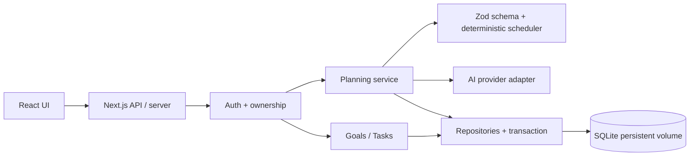

# Kiến trúc và công nghệ

## Quyết định ban đầu

**Next.js 16, React 19, TypeScript, Node 24; SQLite cho MVP một máy; Zod cho hợp đồng dữ liệu; npm lockfile; GitHub Actions.** Đã khởi tạo code theo lựa chọn này. Node 24 có node:sqlite (còn cảnh báo experimental); dùng SQLite qua lớp repository để giảm phạm vi thay đổi sau này. Phải pin bản môi trường đã kiểm chứng và kiểm tra migration trước nâng Node.

Kiến trúc **modular monolith**: một ứng dụng triển khai, chia trách nhiệm bằng module, API và repository. Nhóm 4 Dev chưa cần microservices, message broker hoặc Kubernetes. API AI dùng adapter riêng; provider/model chưa chọn do chưa biết ngân sách và credentials. Không gắn nhãn AI cho scheduler thuần thuật toán hiện tại.

Luồng sản phẩm: người dùng nhập → server xác thực và quota → AI chỉ trả nhiệm vụ/ước lượng theo schema → scheduler phân bổ ngày → preview nháp → người dùng sửa → server validate lại → transaction lưu sau xác nhận. Trạng thái AI: idle / generating / draft / invalid-or-error / confirmed. Lỗi không xóa kế hoạch cũ.

## Ranh giới module và dữ liệu dự kiến

|Module|Trách nhiệm|Thực thể|
|---|---|---|
|identity|Tài khoản, session, ownership|User, Session|
|goals|Môn/chủ đề, kỳ thi, quỹ giờ, timezone|StudyGoal, Topic|
|planning|Nháp, quota, adapter, scheduler, xác nhận|PlanDraft, PlanVersion, AIRequest|
|tasks|Việc theo ngày, trạng thái, phần trăm|StudyTask|

User 1–N Goal; Goal 1–N Topic/Task/Draft; Task có goalId, title, date, estimatedMinutes, doneAt, source, version; Draft có ownerId, goalId, goalVersion, expiresAt và schemaVersion. Task ownership suy qua Goal; mọi endpoint tải theo ownerId. Các index chính goal.ownerId, task(goalId,date), session.tokenHash; FK bật và transaction cho thay kế hoạch. Hash session token, không lưu token raw. Schema này là thiết kế, DB hiện chỉ có schema_meta để smoke test runtime.

Auth dự kiến chọn thư viện duy trì tốt và được review trước US01; không tự viết crypto. Hash password dùng thư viện chuẩn, quản lý CSRF khi cookie auth, rate-limit đăng nhập, secure cookie, generic errors. Đánh giá Better Auth trong spike US01; chưa cài/chưa tích hợp nên chưa tuyên bố tương thích hoặc bảo mật đã đạt.

## Hợp đồng API dự kiến

- `/api/auth/*`: thư viện auth quản lý.
- `GET/POST /api/goals`; `PATCH/DELETE /api/goals/:id`.
- `GET/POST /api/goals/:id/tasks`; `PATCH/DELETE /api/tasks/:id`.
- `POST /api/goals/:id/drafts` gọi AI; `PATCH /api/drafts/:id` sửa; `POST /api/drafts/:id/confirm` có idempotency key và goalVersion.
- `GET /api/today?date=YYYY-MM-DD`; `GET /api/goals/:id/progress`.

Chỉ `/api/health` và `/api/demo/plan` được hiện thực trong starter. Demo plan stateless, không có dữ liệu cá nhân hay provider; không dùng làm endpoint cá nhân trước khi thêm auth/quota.

## SQLite và đường nâng cấp

SQLite giảm chi phí cài DB và hợp với bài nhóm/traffic nhỏ, single server có disk bền. Không đặt file SQLite trên ephemeral/serverless filesystem; không chạy nhiều replica cùng ghi một file qua filesystem mạng. Khi cần triển khai serverless hoặc nhiều instance: chuyển PostgreSQL qua migration và kiểm thử query/transaction; không chỉ thay connection string. Nếu nhóm đã quen PostgreSQL và có host DB, có thể đổi ADR trước Sprint 1.

Không dùng Docker ở môi trường hiện tại vì Node và SQLite đã đủ. Triển khai production/pilot cần TLS, persistent volume, backup/restore, migration, auth và rate limit. Starter chưa sẵn sàng nhận dữ liệu thật.

## Kiểm thử

- Domain: node:test + tsx cho scheduler (đã có); thêm property tests nếu cần, không kiểm lại chi tiết implementation thuần túy.
- Integration: SQLite tạm + API, kiểm tra ownership hai user, transaction rollback, idempotency; US16.
- UI/E2E: Playwright khi có auth và luồng lưu; test hành vi người dùng, không chỉ screenshot.
- AI: fake adapter cho CI; bộ 20–30 fixture gồm tiếng Việt, thiếu giờ, JSON sai, prompt injection, timeout; pass tiêu chí cấu trúc/ràng buộc, người thật đánh giá tính hữu ích.
- Live provider: chạy có quota và key an toàn sau khi cấu hình; kết quả phải ghi riêng, không thay fixture bằng API tính phí trong mọi PR.
